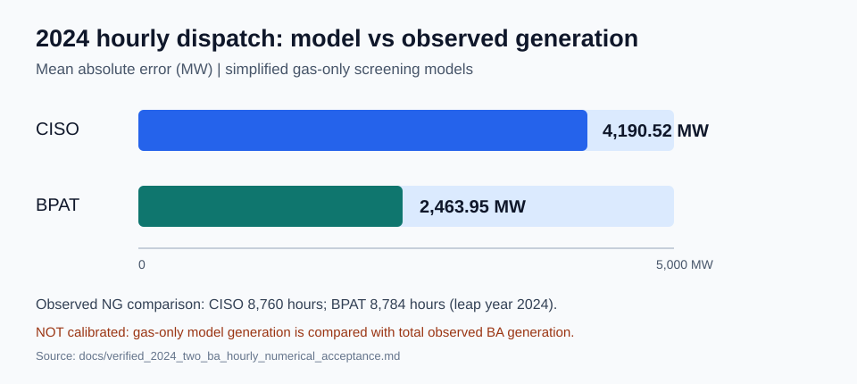
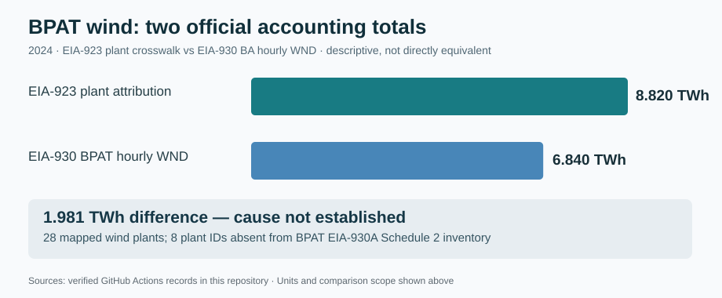
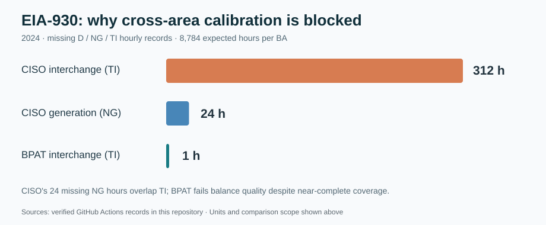
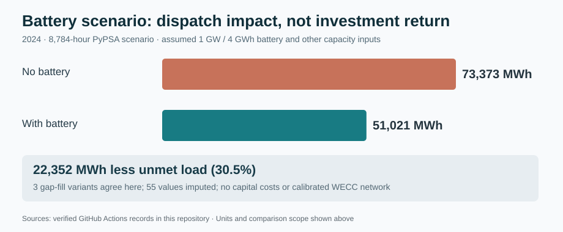
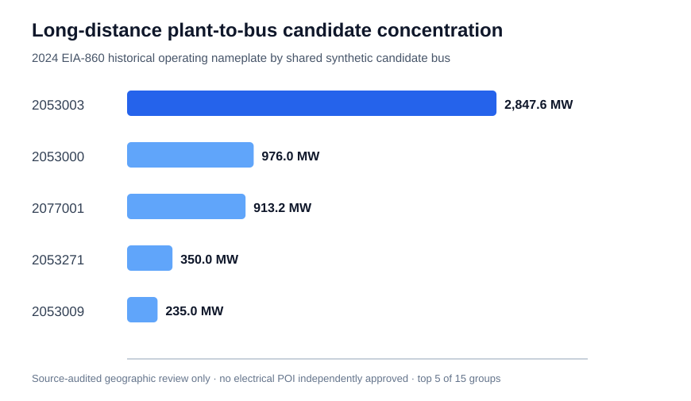

# Western US Energy Transition Modeling | PyPSA + EIA

### Verified publication-figure and solver-objective evidence

[Paper T source-derived Figures T2 and T4](https://github.com/ys30/Energy-Transition-Analysis-PyPSA/actions/runs/42145896229) **passed**: two SVG/PNG research exhibits from verified original EFS2020/ReEDS2022 nonwrapping lag and Idaho frozen-transport-source archives. [Paper S independent 540-case objective and cyclic energy audit](https://github.com/ys30/Energy-Transition-Analysis-PyPSA/actions/runs/42146086492) **passed**: every original HiGHS case reproduces the exact toy objective `5*(renewable direct + charging input) + 90*firm` with maximum discrepancy **$0.00022221**, plus source demand/supply conservation and strict 90% roundtrip charging energy identity. This is a numerical code/results certificate, **not** authentic electricity market costs, generator wind/solar resource, source 2020 UTC, or a real Western network OPF. [Evidence details, figure captions and reproducibility](docs/PAPERS_T_S_VERIFIED_FIGURES_AND_OBJECTIVE_CERTIFICATE.md).

### Coauthor-ready source provenance exhibits and vetted source citations

[Paper T's Idaho source-reference marginal plot CI #42162565936](https://github.com/ys30/Energy-Transition-Analysis-PyPSA/actions/runs/42162565936) **passed**. Together with passing T2/T4, Paper T now has **three source-derived numeric exhibits**. The new T3 shows **separate** 2012 ReEDS2022 reference-month and reference-hour *marginal* errors for Idaho vs Arizona/California; it does **not** claim to reconstruct a 12×24 joint source heatmap without underlying joint records. Publisher metadata, HDF5 source checksums and relevant peer-reviewed literature have been checked in the [coauthor-review evidence report](docs/PAPERS_T_S_COLLABORATOR_REVIEW_AND_SOURCE_CHECKS.md). The full private manuscripts remain outside this public repository. Paper S continues to have 540 previously audited **toy LP** results, not an empirically calibrated Western-grid/storage forecast.

### Paper T collaborator-review package: all four figure slots now source-backed

[Figure T1 source admission (passing CI #42177083314)](https://github.com/ys30/Energy-Transition-Analysis-PyPSA/actions/runs/42177083314) is a reproducible SVG/PNG **conceptual** diagram separating original EFS2020 source checks, independent ReEDS2022 HDF5 checks, actual 289,080-value numerical comparability, and the **still-blocked** publisher-authoritative physical-hour join. Figures T2/T4 were already [validated](https://github.com/ys30/Energy-Transition-Analysis-PyPSA/actions/runs/42145896229); Figure T3 [validated](https://github.com/ys30/Energy-Transition-Analysis-PyPSA/actions/runs/42162565936) **separate** reference-month and clock-hour marginals (not fabricated joint month×hour data). An updated full English manuscript is maintained privately for collaborator review, not in this repository. [Figure ledger, source boundaries and review checklist](docs/PAPER_T_COLLABORATOR_V4_SOURCE_ADMISSION_FIGURE_AND_CHECKLIST.md).

**Paper T editorial audit v5 (2026-11-06):** The private collaborator manuscript now consolidates duplicate conclusions, defines the exact nonwrapping source-index lag sign and boundary exclusion, distinguishes deterministic numeric thresholds from statistical uncertainty, and corrects source/report bibliography against official publisher records. The 289,080 values derive from **related modeled release families, not independent statistical samples**. No original EFS2020 physical UTC clock, Idaho causal time zone correction or real wind/solar hourly join is established. [Public v5 source and manuscript claim audit](docs/PAPER_T_V5_EDITORIAL_AND_PROVENANCE_AUDIT.md).

### Paper T source supplement: 16 verified original-data/figure files (v6)

[Passing source-aggregation CI #42332230767](https://github.com/ys30/Energy-Transition-Analysis-PyPSA/actions/runs/42332230767) assembles a SHA-256-verified **coauthor reproducibility bundle** from prior passing source archives: five original evidence tables T_S1–T_S5 (**33 state-year lags, 42 Idaho sector–subsector/year records, 3 frozen-rule years, 324 separate reference month/hour marginals and 9 residual-overview rows**), three provenance JSONs and Figures **T1–T4** in both SVG and PNG. A per-file SHA-256 manifest and source-run IDs allow independent validation. **Actions retains this bundle for 90 days; it is not a permanent archived DOI.** Original EFS2020 physical-hour mapping remains uncertified; no real wind/solar weather join or OPF is claimed. [Paper T v6 replication instructions and source evidence](docs/PAPER_T_V6_SOURCE_SUPPLEMENT_SHA256_REPRODUCIBILITY.md). The full v6 coauthor-review manuscript remains private.

### Paper T v7 — frozen SHA-256 evidence version (verified)

[Independent source-lock CI #42335868902](https://github.com/ys30/Energy-Transition-Analysis-PyPSA/actions/runs/42335868902) **passed**, checking all 16 previously accepted Paper T supplementary original-data tables, provenance JSONs and T1–T4 PNG/SVG files against a **repository-committed checksum list** (`docs/paper_t_frozen_supplement_sha256.txt`). This prevents silently replacing an accepted result and regenerating its internal checksum file; changes now fail an independent fixed-lock check. The [official NLR EFS catalog](https://data.nlr.gov/submissions/126) explicitly describes EnergyPATHWAYS scenario profiles calibrated for ReEDS, so cross-release annual/hours similarity is **related-product correspondence, not independent empirical replication**. Neither EFS2020 physical source UTC nor a permanent derived-data DOI has been established. [Evidence and v7 collaborator-review caveats](docs/PAPER_T_V7_FROZEN_SHA256_AND_SOURCE_LINEAGE_REVIEW.md). Full private manuscript remains outside GitHub.

### Paper T v8 — journal-fit and publication-release readiness

[Paper T v8 editorial/release readiness](docs/PAPER_T_V8_JOURNAL_FIT_AND_RELEASE_READINESS.md) assesses **Energy Informatics** as the first-fit research journal for source-data provenance, and **Environmental Modelling & Software** as a conditional broader-validation alternative. Current `Scientific Data` Data Descriptor requirements do not fit the existing Results/Discussion manuscript without substantial re-framing. Repo audit (2026-11-07): **GitHub API license=null, no published releases, first created 2026-10-29**. The existing 16-file original-data supplement's source SHA256 lock is verified, but the Actions archive is expiring and **no derived-data or code DOI has been issued**. The complete paper and journal-facing v8 revision remain **private**; **do not interpret the −2/−3 lag as a physical EFS2020 UTC/time-zone correction**.

### Paper T v9 — executable physical-hour join admission contract

[Paper T six-gate policy CI #42399304704](https://github.com/ys30/Energy-Transition-Analysis-PyPSA/actions/runs/42399304704) **passed**, including unit tests for missing/invalid source metadata and falsely favorable numerical lag evidence. The source-independent policy requires **source integrity, native physical calendar, authoritative time crosswalk, weather-year compatibility, verified geography, and unique physical-hour join keys**; all six must have independent source support before a weather/generation join is permitted. The actual EFS2020/ReEDS2022 evidence passport is **BLOCK_PHYSICAL_JOIN**, despite 30/33 close numerical source lag profiles. This is a **tested software/metadata admission interface, not an independently validated physical time conversion**, and its use on unrelated products still needs empirical testing. [Full methods limitations and example code](docs/PAPER_T_V9_FAIL_CLOSED_TIME_JOIN_METHOD.md). The complete collaborator-review manuscript v9 is private.

### Paper T v10 — standards comparison and self-attestation security correction

[W3C PROV-O, CF and Frictionless prior-art comparison](docs/PAPER_T_V10_STANDARDS_COMPARISON_AND_TRUST_BOUNDARY.md) makes the methodological claim narrower and testable: a source-pair **numerical** match does not authorize a physically meaningful hourly join. An adversarial review revealed that a v9 all-`passed=true` *self-attested* passport could previously produce `ADMIT_PHYSICAL_JOIN` without independent source verification. This has been corrected: the current source-agnostic policy **never automatically authorizes physical joins**; all six declarative passes give only `READY_FOR_INDEPENDENT_SOURCE_REVIEW`, and missing evidence still gives `BLOCK_PHYSICAL_JOIN`. The EFS2020/ReEDS2022 pair remains **BLOCKED**. This is a fail-closed **screening contract**, not new PROV/CF/schema standards, not independent provenance proof, and not yet a multi-product benchmark. The v10 full manuscript and review package remain private.

### Paper T v11 — genuine external NASA source-clock positive control

[Passing NASA POWER hourly source CI #42415066759](https://github.com/ys30/Energy-Transition-Analysis-PyPSA/actions/runs/42415066759) downloaded **actual** UTC and local-solar-time (LST) T2M values for 2024-01-15–18 at 35°N, 105°W. Both real API responses had 96 hours. A naive same-hour-label join yielded **7.7874°C MAE**; the [NASA-published UTC→LST −7h conversion](https://power.larc.nasa.gov/docs/services/api/temporal/hourly/) produced **89 nonwrapping matches and 0°C MAE**. Both original JSON responses are retained with SHA-256 in the CI artifact. This tests **one external source family with a publisher-known clock transform**; NASA UTC/LST are alternate time representations of the *same source*, **not independent observations or a verified EFS-weather join**. [Public source-level methods and limitations](docs/PAPER_T_V11_NASA_POWER_EXTERNAL_CLOCK_VALIDATION.md). The full private Paper T v11 now incorporates the control experiment, without claiming independent reviewer source certification.

### Paper T v12 — corrected paired NASA time-join comparison

[Source-pinned NASA POWER CI #42419334016](https://github.com/ys30/Energy-Transition-Analysis-PyPSA/actions/runs/42419334016) **passed** using byte-level SHA256-verified original UTC/LST API JSON. The v11 headline compared *unequal supports* (96 naive label pairs versus 89 converted physical pairs). The corrected **like-for-like 89-hour UTC-anchor comparison** is **8.186629 °C** naive same-label T2M MAE versus **0 °C** after NASA's publisher-defined UTC→LST −7h conversion. The original 96-hour naive MAE **7.787396 °C** remains a separate descriptive statistic, not a paired effect estimate. NASA UTC/LST remain two representations of **one real source**, not independent meteorological observations; no original EFS physical clock has been established. [Methods correction and source hashes](docs/PAPER_T_V12_MATCHED_SUPPORT_NASA_CORRECTION.md). The complete corrected v12 collaborator manuscript remains **private**.

### Paper T v13 — coauthor manuscript consolidated; reviewer-critical gaps explicit

The **private** v13 journal-facing draft has been streamlined: its version-by-version CI and SHA256 histories were moved into a separate private Supplement S1, while retaining all original scientific results, the exact **89-anchor NASA paired comparison (8.186629 vs 0°C)**, the five exhibit captions, and the fail-closed metadata trust boundary. This is **an editorial consolidation, not a new result or CI experiment**. [Public reviewer-risk and conditional *Energy Informatics* Methodology framing report](docs/PAPER_T_V13_CONSOLIDATION_AND_REVIEWER_RISKS.md). Major remaining gaps: original EFS2020 publisher clock definition, independent authority to approve declared metadata, cross-system benchmark, source rights, and a durable derived-data DOI; none is claimed to have been resolved.

### Paper T — rights-aware permanent deposit preflight (2026-11-07)

A **private, unreleased** archive-readiness package now accompanies the v13.2 manuscript. It passes manifest verification for all 16 original EFS/ReEDS evidence files, NASA original-API response hashes, and the five real figures. [Public source-rights and permanent-deposit gate audit](docs/PAPER_T_RIGHTS_AWARE_PERMANENT_DEPOSIT_PREFLIGHT.md): NLR EFS dataset permission requires the **full source license notice in copies and DOE/NREL/Alliance publication credit**; NASA POWER requests attribution; a specific ReEDS2022 redistribution license was not confirmed from the viewed Zenodo record. This repo still has **no declared software license, no GitHub Release, and no new Paper T DOI**. No raw source, private manuscript or deposit was published in this workflow.

### Paper T — metadata-only release preflight (no source bytes distributed)

A [rights-safe, metadata-only candidate](docs/PAPER_T_METADATA_ONLY_RELEASE_PREFLIGHT_NO_SOURCE_BYTES.md) was prepared **privately** while ReEDS 2022 redistribution terms remain unverified. This candidate contains original descriptive metadata, source citations, CI rerun links, draft license-approval questions, and a manifest — **not** the 16 numerical source-evidence files, publisher NASA/EFS/ReEDS JSON/HDF5, figures, private manuscript or unapproved code. Zenodo's general default CC-BY is **not evidence** that the [ReEDS2022 record](https://zenodo.org/records/18461543) is CC-BY. The original full-evidence review package remains private; no public Release, license or Paper T DOI has been created. A written source-specific rights decision and copyright-holder approvals are required before any actual deposit.

### Paper T — verified ReEDS source-owner inquiry prepared (not sent)

[Official ReEDS inquiry channel and two exact unresolved source questions](docs/PAPER_T_REEDS_SOURCE_PERMISSION_AND_CLOCK_INQUIRY.md): the NLR [ReEDS team page](https://www.nlr.gov/analysis/reeds/) provides `ReEDS.Inquiries@nlr.gov`. A **private, unsent** draft requests (1) the specific reuse license for [ReEDS 2022 demand-profile record](https://zenodo.org/records/18461543) and permission for Paper T derived tables/figures, and (2) a source-authoritative mapping for **original EFS2020 `LocalHourID`** (not merely the documented ReEDS2022 CST 2012 reference calendar). **No permission, source clock certification, public deposit or new DOI has been obtained.**

### Paper T v13.3 — scientific novelty and method-scope review

[Scientific review and source-checked prior art](docs/PAPER_T_V13_3_SCIENTIFIC_NOVELTY_AND_METHOD_SCOPE_REVIEW.md) adds the closely related **Yan et al. (2026)** building-energy time-synchronization work and existing W3C PROV time-consistency guidance. The defensible research claim is a **source-forensics case plus a conservative join-abstention screening record for planning demand/weather/resource inputs**, **not** a novel general clock-synchronization algorithm or a demonstrated superior standard. Canonical table T_S1 verifies **all overlapping hourly errors <1 MW** in 30 non-Idaho best-lag cases; Idaho remains exceptional. The six gates are explicitly **context-specific**, and all-true self-declarations do not authorize a physical join. A private coauthor v13.3 manuscript and full T1–T5 figure/source-evidence ZIP were independently verified; **no new experiment or publication**.

## Research deliverables — two separate tracks (November 2026)

**Engineering evidence is verified; neither manuscript is currently submission-ready.** We have separated **Paper T, temporal provenance** (11 Western states × 3 years × 8,760 = **289,080 EFS2020/ReEDS2022 source-hour comparisons**, plus Idaho original sector/subsector and fixed-shift holdout falsification) from **Paper S, source-bounded cyclic-storage sensitivity** (**540 solved full-year HiGHS LP cases** across 20 EFS load zones × 3 planning years × 3 explicitly synthetic supply shapes × 0/4/8-hour battery durations). See the [two-paper research roadmap and exact evidence boundaries](docs/PROJECT_B_TWO_PAPER_RESEARCH_ROADMAP.md).

**Key caution:** a numerical −2/−3 source-index match does not certify the EFS2020 physical UTC calendar; the 540 storage cases use *synthetic renewable availability and toy economics*, not actual Western Interconnection dispatch or observed curtailment. The complete research manuscripts are maintained privately and are **not** published in this repository.

[](https://github.com/ys30/Energy-Transition-Analysis-PyPSA/actions/workflows/ci.yml)
[](https://github.com/ys30/Energy-Transition-Analysis-PyPSA/actions/workflows/bpat-wind-empirical.yml)

**Portfolio project | Python · PyPSA · HiGHS · pandas · U.S. EIA data · reproducible GitHub Actions**

A reproducible modeling and data-validation pipeline for western U.S. electricity-transition research. The strongest delivered components are **hourly balancing-authority dispatch prototypes, official EIA data ingestion and reconciliation, automated data-quality audits, and PyPSA network optimization tests**. Each finding is linked to a verified run or documented limitation.

> **Scientific status:** The 2024 CISO and BPAT pilots are **independent, gas-only engineering screening models**, not calibrated historical simulations or a coupled WECC network. Synthetic scenario figures and transmission test fixtures must not be interpreted as empirical energy-transition forecasts.

## Latest source-hour and archive equivalence gate (November 2026)

The [source-to-archive full-hour validation](docs/verified_efs_source_to_archive_hourly_equivalence.md) now passes against original archived 2030/2040/2050 seven-state EFS zonal CSV and Load-only PyPSA NetCDF from Actions run 41281576025. The [source-data CI run 42055638619](https://github.com/ys30/Energy-Transition-Analysis-PyPSA/actions/runs/42055638619) compares **each zonal Load MW value at every one of its 8,760 archived hours**, rather than relying only on an annual checksum. It validates the project's staged `local_hour_id` order against archived Load values; it does **not** establish a physical UTC chronology.

The same archived-source CI confirms the **2040 leap-year label issue** (the synthetic 8,760-hour 2040 calendar includes Feb 29 and excludes Dec 31), with **7,344 different month/day/hour labels** compared with the pinned nonleap 2018 ordinal template. No original source files were altered, and no simultaneous generation/weather/Western-grid OPF has been admitted. Original EFS timezone/DST conventions and network electrical/calibration evidence remain unresolved.

## New generator interconnection evidence gate — November 2026

A [passing independent EIA-860/Southwest Power Pool evidence grading CI](https://github.com/ys30/Energy-Transition-Analysis-PyPSA/actions/runs/42073377310) audits three 2024 source plants totaling **1,647.7 MW** of historical nameplate against the geographically assigned **synthetic** source-model bus `2053003` (115 kV). Official named evidence identifies Sagamore Wind's Crossroads 345-kV substation context and a Hobbs 230-kV receipt-point context; Cunningham documentation is unit-side voltage, **not** a comparable high-voltage POI. Neither a nominal-voltage discrepancy nor a nearby geographic bus independently authenticates a plant-to-network electrical tie. **Approved generator injections remain 0 MW**, and full Western physical OPF remains blocked. [Methods and limits](docs/eia860_source_voltage_vs_synthetic_bus_2024.md).

**Source-NetCDF topology confirmation:** [Real archived-network CI #42079066900](https://github.com/ys30/Energy-Transition-Analysis-PyPSA/actions/runs/42079066900) independently re-imports the source synthetic Western NetCDF and confirms geographically chosen candidate bus `2053003` is **115 kV**, with **two incident Lines** to `2053019` and `2053021`, and **zero incident Transformers**. This is **not** a utility POI match, a complete physical connectivity audit, or an approved generator injection. The [detailed audit](docs/eia860_archived_synthetic_candidate_structural_validation.md) retains Line/Transformer/Link distinctions and blocks physical dispatch claims.

## Full-8,760-hour EFS source-demand illustrative supply sensitivity

A [successful seven-state source-data workflow #42091677548](https://github.com/ys30/Energy-Transition-Analysis-PyPSA/actions/runs/42091677548) processed **20 independently modeled load zones** for each of 2030, 2040 and 2050, with 8,760 original EFS LocalHourID ordinals in each year. Verified seven-state zonal demand is **274.707, 306.839 and 350.871 TWh**, respectively. Three hypothetical renewable nameplate-to-zone-peak ratios (30%, 60%, 90%) and a **constant assumed 50% availability** give **illustrative** renewable energy shares of about **24.6%, 49.2%, 73.0%**, respectively. At the 90% nameplate ratio, the **modeled** unused available renewable energy is **2.200, 2.460 and 2.817 TWh**, respectively. These figures use a fixed 120%-of-peak hypothetical firm plant and assumed marginal costs of $5/$90 per MWh; **they are not empirical renewable profiles, actual curtailment, investment outcomes, or a network-constrained PyPSA OPF**. No interzonal transmission, weather synchronization or real plant POI is admitted. [Methods, assumptions and data limitations](docs/efs_ordinal_full_year_illustrative_supply_screen.md).

## Equal-annual-energy supply-shape uncertainty: 27 source-demand scenarios (November 2026)

The [passing 27-case experiment #42099467157](https://github.com/ys30/Energy-Transition-Analysis-PyPSA/actions/runs/42099467157) compares constant 50% hypothetical renewable availability with two opposite **mathematical ordinal-24 supply waves** using the same verified seven-state EFS source demand (20 zones; 2030, 2040, 2050). Each supply profile has **exactly the same annual mean 50% availability and the same zonal nameplate assumption**, but its coincidence with demand differs. At a 90%-of-peak hypothetical renewable nameplate in **2030**, modeled renewable supplied share is **73.0%** for flat availability versus **64.4%** for waveform A, and modeled unused hypothetical renewable availability rises from **2.200 to 25.893 TWh**. These are sensitivity calculations driven by assumed supply shapes—not measured wind/solar production, empirical grid curtailment, real costs, or PyPSA network OPF. The ordinal waves **do not correspond to certified physical local time/UTC or actual daily irradiance**. [Full result table and methodology](docs/efs_ordinal_equal_energy_shape_sensitivity.md).

## New: EFS seven-state ordinal-only storage shifting sensitivity

[Source-backed CI #42100384015](https://github.com/ys30/Energy-Transition-Analysis-PyPSA/actions/runs/42100384015) passes all **27** scenarios crossing 2030/2040/2050, three equal-annual-energy **synthetic** renewable supply profiles and 0/4/8-hour **hypothetical** battery durations across **20 EFS load zones**. At a 90%-of-zone-peak illustrative renewable nameplate and the mathematical `ordinal24_wave_A` shape in **2030**, model unused renewable energy is **25.893 TWh** without storage, **9.445 TWh** with 4 hours and **2.605 TWh** with 8 hours; illustrative firm backup drops from **97.871 to 76.930 TWh** from zero to 8 hours. Storage efficiency is assumed 90%, battery power 25% of peak; nonzero terminal SOC is explicitly retained and excluded from delivered load. **None of these values are real curtailed wind/solar energy, verified storage savings, prices, grid-constrained OPF, or investment estimates.** No true UTC/weather alignment, real generator POI or transmission network is admitted. [Full table, code, assumptions and SOC accounting](docs/efs_ordinal_battery_surplus_shifting_sensitivity.md).

## New: source-backed cyclic-SOC HiGHS battery LP validation

[Successful real-source CI run #42103133043](https://github.com/ys30/Energy-Transition-Analysis-PyPSA/actions/runs/42103133043) validates **54 independently solved HiGHS linear programs** (2030/2040/2050; two high-demand EFS zones per year; three **hypothetical** renewable supply shapes; 0/4/8-hour assumed batteries) over the first **168 source LocalHourID ordinals**. Unlike earlier greedy-storage screens, each LP enforces **initial SOC = terminal SOC = 0**, plus hourly load/renewable balances and bounded battery power, capacity and efficiency. For mathematical waveform A in the scoped 2030 two-zone window, hypothetical unused energy falls from **1,013.318 MWh** (no storage) to **0 MWh** with 4h storage, with **911.986 MWh** less assumed firm generation; 8h shows no further change *in this specific window*. **Not an annual forecast:** input demand is sourced EFS, but supply and battery are synthetic, only two zones and 168 ordinals are modeled, and neither physical UTC nor a real Western transmission OPF is certified. [Mathematics and source-run evidence](docs/efs_cyclic_soc_highs_lp_pilot.md).

## Fully validated 8,760h cyclic battery LP across all 20 EFS load zones

[Successful 540-case source-backed HiGHS workflow #42107237659](https://github.com/ys30/Energy-Transition-Analysis-PyPSA/actions/runs/42107237659) solves **20 independently modeled EFS zones × 2030/2040/2050 × 3 mathematical renewable availability shapes × 0/4/8-hour hypothetical battery**: **540 full-year cyclic LPs** in 12 successful zone batches plus an independent aggregation gate. All LPs used 8,760 original source hourly ordinals and enforce **initial SOC = terminal SOC = zero**, supply-demand conservation and solver feasibility. The aggregate zero-battery cases independently reproduce the prior source-backed demand/supply screening values. For the **2030, 20-zone wave-A hypothetical** at 90%-of-zone-peak renewable nameplate, modeled unused availability declines from **25.893 TWh** with no battery to **9.466 TWh** (4 h) or **2.626 TWh** (8 h); hypothetical firm generation declines from **97.871 to 76.930 TWh** in the latter case. Unlike the earlier noncyclic greedy sensitivity, these LP scenarios have matching zero terminal storage inventory. **This is a genuine mathematical optimization over sourced EFS load but NOT empirical storage value, real wind/solar data, realistic generation costs, physical WECC power flow, or a calibrated future system.** The source EFS timezone remains uncertified and no interzonal transmission or real generator POI is modeled. [Methods, all-year result table and limits](docs/efs_8760h_cyclic_storage_scaleup.md).

## Verified source-anchored 540-LP research figures and time-source admission

A [passing figure-build CI #42108416559](https://github.com/ys30/Energy-Transition-Analysis-PyPSA/actions/runs/42108416559) produces **three SVG + PNG research figures** directly from the **original verified 540-LP aggregate artifact**, with regression tests and a machine-readable evidence manifest. The exhibits compare 2030 model-defined unused *hypothetical* renewable energy across assumed 0/4/8-hour batteries and flat/wave A/wave B shapes; compare wave-A unused supply and illustrative firm generation for 2030/2040/2050; and illustrate the marginal assumed firm-energy reduction from extending storage duration. The images are available in the run's `efs-540-lp-evidence-labeled-publication-figures` artifact, not presented as calibrated real-world figures. Their source is seven-state EFS projected demand, with **synthetic renewable/battery assumptions and no authenticated physical Western OPF**. The original EFS 2020 source `LocalHourID` timezone remains unconfirmed: [newer ReEDS 2022/2025 hourly profiles' CST descriptions cannot be transferred to the original EFS release](docs/efs_vs_reeds_hourly_clock_source_admission_2026.md).

## New independently sourced 2024 hourly solar/wind shape evidence — not a future resource forecast

[Successful original EIA-930 hourly archive audit #42111171369](https://github.com/ys30/Energy-Transition-Analysis-PyPSA/actions/runs/42111171369) verifies **2,688 historical hourly observations** across four complete 168-hour 2024 windows, CISO/BPAT and solar/wind (16 BA×fuel×week panels). The audit conserves *signed* net generation and flags negative source hours rather than clipping to zero. Examples: CISO observed **solar 542.511 GWh in the winter week (94 negative-net hourly observations)** and **1,063.098 GWh in the summer week (46 negative-net hours)**; BPAT observed wind **204.830 GWh in the winter week** versus **103.634 GWh in the summer week**. These are real **reported net generation**, not unconstrained availability, renewable capacity factors, or forecasts for the separate 2030–2050 EFS 540-LP synthetic supply model. The original EFS `LocalHourID` weather year/UTC alignment remains uncertified; **no cross-dataset future-year join or physical Western OPF has been admitted**. [Original archived data tests and signed-shape measurements](docs/eia930_2024_observed_hourly_supply_shape_evidence.md).

## EFS ↔ EIA-930 time alignment: original-source admission audit (fail closed)

[Successful provenance CI #42112741582](https://github.com/ys30/Energy-Transition-Analysis-PyPSA/actions/runs/42112741582) reopens the independently validated original **EFS 2030/2040/2050 source demand** (7 states, 20 zones, 8,760 original ordinal-hour keys/year) and **EIA-930 2024 historical observed solar/wind net generation** (four observed weeks, 16 BA×fuel×season panels, 168 consecutive UTC-hour entries per panel). The new cross-source gate records both source-file SHA-256 hashes, verifies exact source chronology and population, and **correctly refuses any invented EFS–EIA-930 hourly join** (zero joined rows). Specifically, it does not invent EFS `LocalHourID` UTC, 2040 leap-day handling, future weather-year identity, ReEDS-zone/BA electrical correspondence, or capacity-normalized future wind/solar availability. A passing refusal test is an evidence-quality result, **not a physically synchronized wind/solar supply experiment**. [Exact evidence policy and test methods](docs/efs_eia930_cross_source_hourly_join_admission_2026.md).

## Authenticated alternative clock source: official ReEDS 2022 reference HDF5 (separate branch)

[Successful original-publisher HDF5 source CI #42117983010](https://github.com/ys30/Energy-Transition-Analysis-PyPSA/actions/runs/42117983010) independently downloaded and verified the official [2022 ReEDS EFS_REFERENCE HDF5 release](https://zenodo.org/records/18461543) against its published MD5 (`7b2055d43200744a16a8c4fed68b1a17`). The source covers **11 Western states × 2030/2040/2050 = 33 source state-year profiles**, each 8,760 original 2012 representative weather-year hours. The **native HDF5** index has explicit `-06:00` offset and was validated against the complete 2012 CST series, retaining **Feb 29** and omitting **Dec 31**. Example **2030, *this separate ReEDS 2022 release*** source state-year sums: CA **284.614 TWh**, AZ **89.416 TWh**, CO **64.966 TWh**. These are **not** the existing original 2020 EFS `Reference_Moderate` values and their clocks and projected model demand cannot be silently conflated. [Independent HDF5 evidence and exact source scope](docs/independent_reeds2022_reference_hdf5_source_probe.md).

Separately, [source-intake CI #42117188587](https://github.com/ys30/Energy-Transition-Analysis-PyPSA/actions/runs/42117188587) passed deterministic tests for proposed **2012 WIND Toolkit/NSRDB** site-CSV time and value validation, **without claiming either real resource dataset has been retrieved**. No weather-driven EFS2020 hourly supply join, certified renewable capacity factors, or Western physical OPF is admitted. [Weather-resource intake plan](docs/verified_candidate_2012_renewable_resource_intake_plan.md).

## Source-forensic finding: EFS2020 vs independent ReEDS2022 289,080 hourly MW values

[Successful original-source full-hour audit #42120010571](https://github.com/ys30/Energy-Transition-Analysis-PyPSA/actions/runs/42120010571) compares **all 11 states × 2030/2040/2050 × 8,760 source hours** between archived NLR EFS 2020 `Reference_Moderate` state-hour source and the separately downloaded, publisher-MD5-verified ReEDS 2022 `EFS_REFERENCE` HDF5, including explicit ±12-hour source-index shifts. **The regional annual load totals agree to displayed precision, but the unshifted hourly profiles do not match.** With an integer **−2-hour** shift for AZ/CO/MT/NM/UT/WY or **−3-hour** shift for CA/NV/OR/WA, **all 8,760 state-year hours of those 30 state-year cases fall within 1 MW** of the respective independently sourced HDF5 sequence. The mean absolute difference is approximately **0.25 MW** and is consistent with source-release rounding/processing differences, **not strict source equality**. **Idaho is an unresolved exception:** its best fixed-shift MAE is **17.27/19.31/22.10 MW** (2030/2040/2050), versus 6.45/7.21/8.25 MW under an **exploratory, nonphysical** −2/−3 mixture, which still leaves thousands of residual discrepancies. **This is a quantitative cross-release index-alignment lead, not authoritatively verified `LocalHourID` UTC, evidence of actual Idaho timezone contributions, or an approved 2020 EFS–weather hourly join.** No existing EFS-LAF/load-only network or 540 synthetic-supply storage LP has been silently modified. [Exact data evidence, residuals and scientific limits](docs/original_efs2020_vs_reeds2022_hourly_cross_release_audit.md).

## Source time alignment robustness: 33 nonwrapping EFS/ReEDS comparisons

[Original-source nonwrapping CI #42122065064](https://github.com/ys30/Energy-Transition-Analysis-PyPSA/actions/runs/42122065064) verifies that the previously detected −2/−3-hour EFS2020–ReEDS2022 **numerical source-index displacement** is **not an artifact of `np.roll` wrapping December/January**. All 33 state-year pairs retain their previous best shift when only actually overlapping hourly indices are compared. **30 non-Idaho pairs** remain below 1 MW residual in every overlapping source hour; the best-versus-runner-up lag error gap is large. **Idaho remains unresolved**, with **8,367/8,408/8,441** overlapped hourly residuals over 1 MW (2030/2040/2050). This strengthens a cross-published-file chronology diagnosis, **not source-specific authority to map EFS2020 `LocalHourID` to UTC or to join wind/solar weather years**. The original EFS raw source is state/sector/subsector aggregated rather than verified Idaho load-by-timezone, so the earlier 83.44% mixture weight is **not a validated time-zone share**. [Methods and original-source results](docs/efs2020_reeds2022_nonwrapping_lag_review.md).

## Pinned upstream EFS time conversion identified (PyPSA-USA source evidence)

[Successful exact-commit source audit #42124175205](https://github.com/ys30/Energy-Transition-Analysis-PyPSA/actions/runs/42124175205) examines **the pinned PyPSA-USA `338af991` code itself** rather than inferring clocks from correlations. The downstream `ReadEfs._apply_timezones()` uses **fixed +7 hours for Mountain** and **+8 hours for Pacific**, computes `UtcHourID=LocalHourID+offset` with **8760-hour annual wrapping**, then uses a **2018 nonleap** template when constructing dates. Its state timezone table assigns **Idaho solely to `US/Mountain`** and explicitly warns the table **does not represent states spanning multiple time zones or exceptions**. This is a verified **downstream engineering assumption**, not the original 2020 EFS publisher's certified `LocalHourID` clock. In particular, it does not by itself establish the cause of the independently observed EFS2020/ReEDS2022 −2/−3-hour cross-release index differences or actual Idaho regional load weights. **No weather-to-load physical-hour joins are admitted.** [Pinned source references and methodological implications](docs/pinned_upstream_efs_clock_idaho_source_forensics.md).

## Idaho anomaly source-localization: year-round residual, not a calendar-boundary artifact

A [passing original-data 2024-source/2012-calendar reference diagnostic #42125517759](https://github.com/ys30/Energy-Transition-Analysis-PyPSA/actions/runs/42125517759) further characterizes the separate **EFS2020 vs ReEDS2022** source-hour problem: Idaho's nonwrapping −2-hour aligned residual has monthly MAE **13.868–19.876 MW (2030)**, **15.486–22.226 MW (2040)**, **17.739–25.440 MW (2050)**. Excess errors are present throughout the reference year, and the longest consecutive runs exceeding 1 MW last **190/144/275 hours** respectively. The **2030 ReEDS2022 reference-clock hour-08:00** residual MAE is **46.907 MW** versus **4.242 MW at 05:00**. In comparison, Arizona and California control series remain around **0.25 MW** MAE with zero hours above 1 MW. This is authenticated **source-file mismatch structure**, not proof of Idaho time-zone load composition or an EFS publisher-approved UTC clock. [Full methods, grouped results, and source limitations](docs/efs_idaho_source_residual_seasonality_audit.md).

## Verified original Idaho EFS four-sector reconstruction and held-out source-clock hypothesis test

[Passing original-source CI #42128806803](https://github.com/ys30/Energy-Transition-Analysis-PyPSA/actions/runs/42128806803) reopens NLR EFS 2020 `Reference_Moderate` **original Deflate64 ZIP** and selects **367,920 original Idaho sector/subsector input rows** for 2030/2040/2050. Hourly Commercial, Industrial, Residential and Transportation source sums reproduce every one of the original **26,280 Idaho state-year-hour MWh** records. An 81-case **synthetic** sector-specific {-1,0,+1} hour-index perturbation is selected on the first half of each year, then evaluated out-of-sample. In 2030, the training-selected **Transportation-only +1h** perturbation reduces held-out cross-release MAE from **17.796 to 15.586 MW**; in **2040 and 2050, the unshifted baseline itself is selected**, with no improvement. This **rejects a stable single-sector shift explanation** for the persistent Idaho EFS2020/ReEDS2022 inconsistency, and does not establish physical Idaho timezone membership, original EFS UTC or real wind/solar supply joins. [Original-source experiment and cautious interpretation](docs/efs_idaho_original_sector_hour_forensic.md).

## Source-backed Idaho Subsector energy and frozen cross-year hour-index diagnostic

[Passing original-source CI #42131969905](https://github.com/ys30/Energy-Transition-Analysis-PyPSA/actions/runs/42131969905) verifies **14 authentic original EFS2020 Idaho Sector×Subsector categories** (367,920 source rows, 2030/2040/2050), with exact annual demand reconciliation against the independently archived original state-hour load. The 2030 candidate **Transportation +1 source index hour** was frozen and applied to 2040/2050 without retuning. Compared with the unchanged four-sector source, its **first-half** absolute-error changes were **+0.073 MW improvement (2030), −0.757 MW (2040), and −0.988 MW (2050)**, whereas **later-half** improvements were **+2.210/+2.013/+2.227 MW**. Thus 2040/2050 have a **train/holdout sign reversal**; a per-year first-half model rightly prefers no shift in those years, even though a fixed candidate improves the later half. This is a source-index evaluation-window effect, **not a validated physical Idaho timezone or source-authorized EFS2020 LocalHourID→UTC conversion**. No empirical renewable/weather join or physical Western OPF has been performed. [Detailed source metadata, subsector contributions and CI-verified results](docs/efs_idaho_subsector_frozen_crossyear_audit.md).

## Project A → B integration status (audited)

[**A contribution, repository boundaries, and revised B milestone progress**](docs/A_TO_B_CONTRIBUTION_AND_PROGRESS_AUDIT.md)

Project A (`ys30/lut-to-pypsa`) remains an **independent global annual
LUT-DEMAND methodology demonstration**. Its authentic data is continent-level
electricity energy-service demand; **no direct state-hour Western EFS input,
actual ReEDS LAF weights, or empirical Western solve has been admitted into B
from A**. B reuses methodological lessons, not A's regional quantities.
Engineering CI success must not be conflated with research calibration.

**A handoff contract (not a Western-US input):** Project A now emits a
`handoff_contract` in `lut_pypsa_input_manifest.json` with an artifact
SHA-256, snapshot count, hourly resolution, MW units, source quantity, and
`requires_explicit_geographic_mapping=true`. The associated
`lut_load_only.nc` is a five-continent, flat-profile, load-only network.
**B must reject it as an empirical Western-US load input** unless an
independently documented geographic crosswalk and energy-service-demand to
electricity-load transformation are supplied and validated. A matching hash
establishes artifact identity, not regional compatibility. B's EIA/EFS
pipelines remain the regional source of record; no A demand is silently
substituted for them.

## Recruiter quick view

[**Quantitative evidence, four charts and A/B/C project differentiation**](docs/recruiter_evidence_brief.md)



## Results at a glance — verified evidence and modeled scenarios

The figures below are versioned in this repository and distinguish official source measurements from assumption-dependent optimization.



The totals come from different reporting populations. See the [EIA-930A population investigation](docs/verified_bpat_wind_eia930a_population_2024.md) and [wind reconciliation](docs/verified_bpat_wind_end_to_end_official_2024.md). The 1.981 TWh gap is **not** a measured loss or curtailment.



The [hourly audit](docs/eia930_2024_interchange_diagnostic_findings.md) identifies 312 CISO TI hours, 24 overlapping CISO NG hours, and one BPAT TI hour. Interchange observations are **not** independently calibrated physical branch flows.



The [8,784-hour storage gap-fill sensitivity](docs/verified_annual_storage_gap_sensitivity_2024.md) reports 73,373 MWh without storage versus 51,021 MWh with a hypothetical 1-GW/4-GWh battery: 22,352 MWh less model-defined unmet load (30.5%). This is a **scenario-conditioned dispatch comparison**, based on assumed generator capacity, costs, 55 imputed renewable source observations and a $10,000/MWh shortage penalty; not a historical battery investment return. The modeled $315.9933 million objective improvement includes $223.52 million in assumed shortage-penalty reductions and excludes battery capex/degradation. Three gap-fill treatments yield the same battery dispatch metrics under these assumptions, not generalized robustness.

**Most recent verified integration:** [NARIS Western 35-zone/24-hour synthetic OPF](docs/verified_naris35_24h_synthetic_load_opf.md) · [full-network CI success](https://github.com/ys30/Energy-Transition-Analysis-PyPSA/actions/runs/41718188340) · [main test CI success](https://github.com/ys30/Energy-Transition-Analysis-PyPSA/actions/runs/41718188226). The experiment uses source-published *directional planning Link capacities*; demand, supply and cost are hypothetical. **Not a calibrated WECC or historical Western dispatch estimate.**

## 11-state EFS candidate load-synchronization experiment (source-backed, not calibrated)

The [verified 2030–2050 mixed-clock sensitivity study](docs/verified_eleven_state_efs_candidate_mixed_clock.md) combines **actual archived NLR EFS demand** for 11 Western states with the **unchanged seven-state LAF pilot** and **numerically audited candidate weights** for CA/NV/OR/WA. The pinned +7/+8 hour shift changes candidate coincident peak by **+23.54 MW (2030), +31.84 MW (2040), +35.97 MW (2050)** relative to an unshifted LocalHourID comparison, while conserving total annual allocated load (**768.25, 848.88, 972.30 TWh**, respectively). [Verified workflow](https://github.com/ys30/Energy-Transition-Analysis-PyPSA/actions/runs/41764316720).

**Independent geographic corroboration:** Both [official Census TIGER 2023 state polygons](docs/verified_census_border_bus_independent_overlay.md) and the [Natural Earth 10m source shape family used by pinned upstream PyPSA-USA](docs/verified_pinned_natural_earth_full_state_border_comparison.md) place network node `2030005` in **California** and node `2013019` in **Oregon**, matching their independently inferred original LAF denominators despite later exported labels of Nevada and Washington. The Census estimated border distances are **198 m** and **4.42 km**, respectively. The exact historical Natural Earth Cartopy archive and dropped `full_state` bus labels remain unavailable, so the four-state mapping is **still a candidate**.

**Scope guard:** The exact original `full_state` GIS for the two crossing source-denominator buses, actual EFS UTC/DST interpretation and Western generator/weather snapshot compatibility have **not** been independently certified. This is a reproducible **candidate temporal sensitivity**, **not** a verified Western hourly demand profile, empirical OPF, emissions forecast, or electricity-transition outcome.

**Western generation admission gate:** The [four-network real source audit](docs/verified_western_efs_generation_source_admission.md) confirms that the original **10,157-bus Western topology** and all three load-bearing EFS 2030/2040/2050 NetCDF scenarios have **zero Generator components**, despite the EFS networks' 20 Load components each. [Source-admission CI](https://github.com/ys30/Energy-Transition-Analysis-PyPSA/actions/runs/41771905008). Existing EIA-860/EIA-923/EIA-930 pipelines provide historical generation evidence, **not** source-verified future unit-to-bus mapping, hourly availability or 2030–2050 costs. Full Western empirical dispatch remains blocked until authentic generation and time-alignment inputs are integrated.

**Official generator-level source staging now available:** The [verified 2024 EIA-860 generator-to-Western-bus candidate run](docs/verified_eia860_2024_generator_bus_staging.md) produces a **5,665-generator / 3,223-plant** source inventory representing **268,692 MW of operating nameplate**, preserving each unit ID, fuel, state, BA and nearest geographic candidate bus. **88 generator rows (5,831.9 MW)** are more than 50 km from their candidate bus and require priority connection review. [Successful actual-data CI](https://github.com/ys30/Energy-Transition-Analysis-PyPSA/actions/runs/41772568847). **Zero electrical plant-to-bus connections are independently approved**, and this historical nameplate screen is not a validated 2030–2050 future fleet. No unsourced generators were inserted into PyPSA.

**Priority electrical-interconnection evidence queue:** A [verified generator-to-plant risk triage](docs/verified_2024_generator_plant_poi_triage.md) now identifies **63 distinct plants / 88 EIA-860 operating generator rows** whose nearest geographic source-topology buses are over **50 km** away, totaling **5,831.9 MW** of 2024 nameplate. The top 20 source plants cover **4,922.7 MW** (~84.4%) of those candidate-risk MW. [Source CI](https://github.com/ys30/Energy-Transition-Analysis-PyPSA/actions/runs/41773439738). This is an audit prioritization rather than independently confirmed electrical connectivity, generator admission or 2030–2050 dispatch modeling.

**New network-crosswalk concentration finding:** [Verified cluster audit](docs/verified_2024_distant_plant_bus_collision_risk.md) shows that the **63** distant EIA source plants (5,831.9 MW historical nameplate) collapse into only **15** nearest synthetic candidate buses; **58** plants (5,118.3 MW) share a candidate bus with at least one other distant plant. The three largest candidate IDs (`2053003`, `2053000`, `2077001`) account for **4,736.8 MW** of that screened subset. [Successful CI](https://github.com/ys30/Energy-Transition-Analysis-PyPSA/actions/runs/41774150894). This is an **uncertainty finding in the GIS-to-synthetic-topology crosswalk**, not physical grid congestion or approved plant connections.



**Official plant identities and transmission-document evidence:** The [verified named-plant review](docs/verified_2024_named_plant_poi_and_sagamore_external_evidence.md) reconciles **all 63** geographically distant 2024 EIA-860 plants to their official facility names and original source coordinates. A published SPP agreement identifies **522-MW Sagamore Wind** as connecting to **Crossroads 345-kV substation**, while the model's nearby geographic candidate bus remains **unverified**. [Successful EIA identity CI](https://github.com/ys30/Energy-Transition-Analysis-PyPSA/actions/runs/41774793024). No synthetic network bus has been promoted to an independently approved POI.

**Source-to-grid evidence hierarchy (three priority EIA plants):** A [new CI-verified SPP evidence ledger](docs/verified_top3_spp_eia_poi_evidence_hierarchy.md) distinguishes **Sagamore Wind** (522 MW; named **Crossroads 345-kV substation**), **Hobbs Generating Station** (681.5 MW; SPS **230-kV service receipt point**) and **Cunningham** (444.2 MW; 13.8/20-kV **unit-side receipt voltage records**). These claims are from different SPP document types and **do not establish any connection** to their shared geographic candidate synthetic bus `2053003`. [Evidence gate CI](https://github.com/ys30/Energy-Transition-Analysis-PyPSA/actions/runs/41775561325). All three EIA source identifiers and historical nameplates are preserved; zero generator-to-synthetic-bus POIs are certified.

**Actual archived bus-topology test of EIA generator mapping risks:** The [verified Line+Transformer graph audit](docs/verified_eia860_top3_actual_archived_bus_topology.md) finds that geographic candidate bus `2053003` is a **115-kV, 2-line, 0-transformer** node in the pinned 10,157-bus source topology, yet 21 distant EIA plants (2,847.6 MW **historical source nameplate**) are assigned there by a nearest-neighbor rule. `2053000` also has 2 direct lines/0 transformers (976.0 MW candidate), and `2077001` has 4 lines/0 transformers (913.2 MW candidate). [Real-network CI evidence](https://github.com/ys30/Energy-Transition-Analysis-PyPSA/actions/runs/41779717439). **This highlights a modeling crosswalk risk, not physical grid congestion, transfer limits or verified interconnection.** The graph excludes separate PyPSA Links and is not an all-device electrical connectivity test.

**New Western topology source-classification result:** [Verified six-DC-Link inventory](docs/verified_western_six_link_connectivity_sensitivity.md) shows that 6 modeled DC Link components form **three directional forward/reverse pairs** and do not change the Line+Transformer graph's **879 components / 877 degree-zero nodes**. The [verified 877-node source audit](docs/verified_western_877_degree_zero_source_taxonomy.md) partitions those nodes into **157 post-LAF offshore auxiliary nodes** and **720 non-offshore nodes**. Exactly **55** zero-degree buses carry **1,714.97 MW of archived source `Pd`**; this is **not verified unserved load**. [Real-network origin CI](https://github.com/ys30/Energy-Transition-Analysis-PyPSA/actions/runs/41780731794). No source topology change, invented generator or POI approval was made.

**Actual EFS × low-voltage source-topology sensitivity:** [Verified 53-bus EFS audit](docs/verified_efs_53_positive_pd_source_exposure_and_state_concentration.md) uses real 2030/2040/2050 EFS state-hour source data and the original source network LAF, explicitly excluding **2 Texas nodes** outside the 11-state study coverage. The remaining **53 low-voltage, Line+Transformer-degree-zero positive-`Pd` source buses** yield **8.965/9.946/11.388 TWh** of *hypothetical exported-state LAF exposure*, with CA supplying ~24% and the top three states ~53% of the sensitivity total. [Original EFS CI](https://github.com/ys30/Energy-Transition-Analysis-PyPSA/actions/runs/41866601224) · [source-state decomposition CI](https://github.com/ys30/Energy-Transition-Analysis-PyPSA/actions/runs/41869023373). This is **NOT physical bus demand, lost load, an observed grid deficiency or calibrated dispatch**; the original `full_state` denominator and utility source-node electrical types remain unverified.

**Decisive check of *actual* archived EFS load attachments:** A [successful real-NetCDF `Load.bus` audit](docs/verified_actual_efs_load_bus_overlap_53_zero_degree_nodes.md) reimports the original 2030, 2040 and 2050 **seven-state, load-only** PyPSA networks, each with **20 Load components (19 hourly dynamic and one static-zero)** and **274.707 / 306.839 / 350.871 TWh** annual EFS pilot demand. **Zero** Loads actually attach to any of the 53 eleven-state-in-scope positive-`Pd` Line+Transformer-degree-zero source buses; none of the 20 Load targets lies outside the main Line+Transformer graph component. [Verified CI](https://github.com/ys30/Energy-Transition-Analysis-PyPSA/actions/runs/41872002039). This **resolves a prior hypothetical 8.965–11.388 TWh state×LAF screening result**: those TWh are **not observed attached demand or lost load in the archived seven-state pilot**. The future 11-state candidate, actual load-point geography and calibrated 2030–2050 power-flow/dispatch remain unvalidated.

**New empirical QA of representative zonal Load placement:** A [passing direct-from-NetCDF audit](docs/verified_actual_efs_representative_load_bus_selection.md) establishes that the archived **2030 seven-state** EFS pilot selects **all 20 Load buses by original first-indexed bus ordering**, with **10/20 target buses having original source `Pd=0`**; **19/20** corresponding zones contain connected, positive-`Pd` alternative buses, and none of the chosen targets is graph-isolated. [CI](https://github.com/ys30/Energy-Transition-Analysis-PyPSA/actions/runs/41872759268). This reveals a **zone-to-bus placement sensitivity** without claiming that `Pd>0` is a utility-verified load delivery location. The [three-year archived-NetCDF Load.bus negative control](https://github.com/ys30/Energy-Transition-Analysis-PyPSA/actions/runs/41872002039) independently proves zero actual Loads attached to the 53 positive-`Pd` zero-degree source buses; the earlier 8.965–11.388 TWh state×LAF screen is *not* actual attached/unserved network energy.

**Verified 2030 EFS zonal load-placement sensitivity (conserved hourly demand):** A [real-source first-bus vs positive-`Pd` multi-bus comparison](docs/verified_efs_2030_pd_weighted_spatial_load_placement_sensitivity.md) finds the original **20 seven-state EFS zonal Loads** shift **99.61% of their annual modeled bus placement (273.648 TWh)** when distributed among connected positive-source-`Pd` buses, while **all 8,760 hourly zonal totals and 274.707 TWh annual EFS source demand stay unchanged**. There are 19 positive-`Pd` eligible zones and one explicit zero-demand/no-candidate fallback. [Passing actual archive CI](https://github.com/ys30/Energy-Transition-Analysis-PyPSA/actions/runs/41874208815). This is a **spatial modeling assumption sensitivity** (single bus vs multi-bus), NOT physically moved electricity, lost power, verified utility load locations or OPF output.

**Three validated EFS load-placement alternatives (no re-simulation):** [Source-preserving 2030 seven-state comparison](docs/verified_efs_2030_three_spatial_load_placement_rules.md) separates (A) original first-indexed zonal bus, (B) a **single** main-network source bus with maximum positive original `Pd`, and (C) **multiple** main-network positive-`Pd` buses with source-weighted splits. Alternative B assigns **100.00%** of nonzero source annual demand to different candidate bus IDs, and C **99.61%**, while **every original 8,760-hour zonal load series and 274.707 TWh total remains unchanged**. [CI passed](https://github.com/ys30/Energy-Transition-Analysis-PyPSA/actions/runs/41874891129). These are positional modeling sensitivities, **not** actual geographic electricity migration, load-shedding, congestion or solved OPF.

**Quantified geographic uncertainty in original EFS zone Load placement:** A [real archived Western bus-coordinate audit](docs/verified_efs_2030_load_bus_geographic_distance.md) finds **153.8 km median, 233.0 km annual-load-weighted mean, and 505.7 km maximum straight-line** separation between original first-bus representatives and alternative maximum-original-`Pd` source bus choices across 20 seven-state 2030 zonal Loads. The NM `p31` candidate pair (`2040690` vs `2080000`) alone is ~505.7 km apart and needs independent state/zone polygon validation. [Passing source-data CI](https://github.com/ys30/Energy-Transition-Analysis-PyPSA/actions/runs/41875462614). **No physical load relocation or transmission-flow impact** has been demonstrated; neither geographic candidate strategy is utility-certified.

**New validated EFS state-polygon and geographic-threshold evidence:** A [successful independent Natural Earth 10m GIS check](docs/verified_efs_2030_geographic_polygon_and_distance_thresholds.md) finds **1/20 original first-indexed EFS Load buses** not covered by its exported-state polygon—**Arizona `p28`, original bus `2040000`**—versus **0/20** max-source-`Pd` candidate buses. The original flagged EFS zonal annual demand is **71.278 TWh**; this is a **geographic screen, NOT proved misallocated or lost electricity**. [GIS CI](https://github.com/ys30/Energy-Transition-Analysis-PyPSA/actions/runs/41876120938). A separately [verified source-distance threshold audit](https://github.com/ys30/Energy-Transition-Analysis-PyPSA/actions/runs/41878146215) shows **7/20** candidate pairs exceed **200 km**, covering zones with **51.61%** of original 2030 annual EFS load, and **5/20** exceed **300 km**, covering **45.73%**. Neither test reconstructs certified historical `full_state` nor authenticates power-flow/utility load delivery.

**Resolved Arizona `p28` GIS boundary risk:** [Passing dedicated all-US-state/border-distance CI](https://github.com/ys30/Energy-Transition-Analysis-PyPSA/actions/runs/41887672429) confirms that original EFS representative bus `2040000` (32.4567°N, -114.689°W) lies only **0.264 km (264 m)** outside the downloaded Natural Earth Arizona polygon; alternative candidate bus `2040003` is inside Arizona. [Verified methodology and constraints](docs/verified_efs_2030_arizona_p28_precise_border_distance.md). This reclassifies the earlier one-of-20 GIS mismatch as **near-boundary source-geography sensitivity**—**NOT proven misplacement of the source zone's 71.278 TWh 2030 annual demand**, nor evidence of unserved power. Historical `full_state` and actual utility/ReEDS delivery boundaries are not independently recovered.

**Independent within-source-zone spatial dispersion QA:** A [new, successful 20-zone original-bus coordinate audit](docs/verified_efs_2030_source_labelled_reeds_zone_spatial_dispersion.md) finds the source-labelled `state × ReEDS zone` groups have a **209.5-km median of zone-specific 90%-radius coordinates**. Relative to each group's descriptive coordinate median, original first-indexed Load buses lie farther away than the maximum-original-positive-`Pd` candidates in **12 zones**; maximum-`Pd` alternatives lie farther in **7**, with **1 identical choice**. NM `p31` has 308 source buses and **322.3 km** source-group p90 radius. [Passing source network CI](https://github.com/ys30/Energy-Transition-Analysis-PyPSA/actions/runs/41926602723). Labels are **not** independently certified ReEDS polygons or actual utility delivery sites, and no load/archive or physical OPF has changed.

**Fixed-commit ReEDS boundary validation (real source GIS):** [Pinned PyPSA-USA `rb_and_ba_areas` polygon audit](docs/verified_efs_2030_pinned_reeds_polygon_20zones_and_two_boundary_cases.md) finds **2/20** original first-indexed 2030 seven-state EFS Load target buses outside their **original raw** `pXX` polygons, versus **0/20** alternative max-source-`Pd` candidates. [Passing full-source CI](https://github.com/ys30/Energy-Transition-Analysis-PyPSA/actions/runs/41960027199). Follow-up [passing source-boundary distance CI](https://github.com/ys30/Energy-Transition-Analysis-PyPSA/actions/runs/41960343309) resolves Arizona `p28` `2040000` as **0.578 km** outside its original raw `p28`, and Montana `p18` `2077004` as **inside original `p19`**, **38.97 km** from raw `p18`. The two flagged zone-level source demands sum to **76.998 TWh**, **NOT validated misplaced/unserved electricity**. Upstream county-majority reassignment and interconnection clipping remain to be reconstructed before concluding that the final `reeds_zone` tags are wrong; no real OPF or approved Load placement was produced.

**Pinned ReEDS polygon and Western source-filter provenance resolved (source-consistent):** [Four passing original-source GIS and rule-validation CIs](docs/verified_efs_2030_montana_p18_county_western_exclusion_mechanism.md) now identify **2/20** original 2030 seven-state EFS first-bus Load candidate locations outside the corresponding **raw pinned ReEDS** polygons: Arizona `p28` is **0.578 km** outside its own raw zone (35 source county buses, 34 inside raw `p28`); Montana `p18` first bus sits in raw `p19` and **38.97 km** from raw `p18`. The pinned upstream **Western interconnection excludes raw `p35` and `p19`**; Montana source county `p30071` has **8 raw `p35`**, **1 raw `p19`**, **1 raw `p18`**, and all **10 finally labelled `p18`**. This is **consistent with** the documented interconnect filtering and county-level label mode, although original post-filter intermediate assignments remain unarchived. [Passing final rule CI](https://github.com/ys30/Energy-Transition-Analysis-PyPSA/actions/runs/41961146759). The flagged source zones represent 76.998 TWh of **modeled annual zone demand**, **not** validated erroneous, stranded or unserved demand. This does not certify utility Load locations or solve Western 2030–2050 OPF.

**Verified 2040 leap-year model-calendar issue:** A [real-NetCDF 2030/2040/2050 EFS Load snapshot audit](docs/verified_efs_2030_2050_archived_snapshot_leap_year_semantics.md) shows all three archived seven-state pilots use **8,760 naive (timezone-unaware) contiguous model hours**; 2030/2050 run Jan 1–Dec 31, but **2040 runs Jan 1–Dec 30 and includes Feb 29, omitting Dec 31**, because 2040 is a leap year. This prevents treating the three saved model calendars as identical month/day/hour chronologies or independently verified UTC. [Passing archived-source CI](https://github.com/ys30/Energy-Transition-Analysis-PyPSA/actions/runs/41961836356). The annual original-source Load totals are unchanged; no automatic timestamp relabeling or unproven wind/solar alignment is claimed.

## Four recruiter-ready work samples

| Work sample | What was implemented | Verified evidence | Status |
|---|---|---|---|
| **1. Reproducible Python research engineering** | Installable package, automated tests, provenance-aware source handling, CI workflows, audit artifacts and plotting | [CI](https://github.com/ys30/Energy-Transition-Analysis-PyPSA/actions/workflows/ci.yml) · [reproducibility guide](docs/reproduce_2024_two_ba_hourly_baseline.md) | **Working** |
| **2. 2024 hourly PyPSA modeling** | Separate CISO/BPAT, 8,784-hour gas-only dispatch pilots; benchmark against observed BA net generation with no gap imputation | [numerical acceptance](docs/verified_2024_two_ba_hourly_numerical_acceptance.md) | **Engineering baseline verified; not calibrated** |
| **3. Official EIA-930 quality and BA accounting audits** | Demand (D), generation (NG), total interchange (TI), hourly coverage, gap-window validation, and conservative calibration eligibility gates | [2024 BA diagnostic evidence](docs/eia930_2024_interchange_diagnostic_findings.md) · [audit workflow](https://github.com/ys30/Energy-Transition-Analysis-PyPSA/actions/workflows/eia930-balance-audit.yml) | **Observed-data audit verified; calibration gates fail** |
| **4. BPAT wind cross-source reconciliation** | Official EIA-923 generation × EIA-860 plant mapping × EIA-930 hourly WND; EIA-930A reporting-population cross-check and 28-plant review queue | [official 2024 cross-source reconciliation](docs/verified_bpat_wind_end_to_end_official_2024.md) · [EIA-930A population check](docs/verified_bpat_wind_eia930a_population_2024.md) | **Pipeline verified; accounting gap unresolved** |

### Selected measured results

- **Chronological modeling:** 8,784 hourly snapshots per 2024 pilot; observed NG comparison pairs **8,760 hours for CISO** and **8,784 for BPAT**. Model-versus-observed NG MAE: **4,190.52 MW (CISO)** and **2,463.95 MW (BPAT)**. These errors reflect simplified gas-only dispatch versus *total observed* BA generation; they are **not acceptable calibrated error claims**. [Verified acceptance](docs/verified_2024_two_ba_hourly_numerical_acceptance.md).
- **Data QA:** For the EIA-930 D/NG/TI triple audit, CISO has **312 missing interchange hours**, including **24 hours also missing NG**; BPAT has **one missing TI hour**. Exact contiguous UTC windows and independent window-consistency checks were verified in the [interchange audit](docs/eia930_2024_interchange_diagnostic_findings.md). **Neither BA passes the historical interchange calibration screening gate.**
- **Wind reconciliation:** Qualified BPAT-attributed EIA-923 wind totals **8,820,435.41 MWh** versus EIA-930 BPAT WND **6,839,734 MWh** (signed difference **1,980,701.41 MWh**); full-year EIA-930 WND has 8,784 recorded hours. No excluded EIA-923 wind source records intersect the matched BPAT plant population in the verified audit. [Evidence](docs/verified_bpat_wind_end_to_end_official_2024.md).
- **Independent source-population discriminator:** Of **28** EIA-923/EIA-860 BPAT-associated wind plant IDs, **20** occur on BPAT's official EIA-930A Schedule 2 reporting inventory and **8 do not**. The eight plants account for **1,802,779 MWh** of qualified EIA-923 generation. **This is evidence of a population-boundary issue, not a verified allocation of the 1.981 TWh difference**; EIA-930A includes generator-level reporting and plant IDs alone cannot reconcile all differences. [EIA-930A audit](docs/verified_bpat_wind_eia930a_population_2024.md).

## Western NARIS zonal integration — verified synthetic case

[**35-zone, 24-hour NARIS Link OPF numerical verification**](docs/verified_naris35_24h_synthetic_load_opf.md) documents a successful HiGHS solve using 131 directional planning interfaces. Total **hypothetical** demand and generation are both 42,840 MWh; the isolated member zone `p19` has 816 MWh of **invented** demand served entirely by **invented** local backup. This is an engineering integration and energy-balance result, **not** a historical Western-US dispatch simulation, calibrated grid, unmet demand estimate, or quantified transition benefit.

## A separate solver-verified PyPSA `Line` example

A deliberately **synthetic** two-bus PyPSA + HiGHS linear-optimization sensitivity test demonstrates congestion-driven dispatch. A line rated at **25 / 50 / 125 MW** carries **25 / 50 / 100 MW**, respectively, and local backup dispatch falls **75 / 50 / 0 MW** for 100 MW load. This confirms solver integration, **not** real CISO–BPAT transmission capability or historical savings. [Verified line sweep](docs/verified_synthetic_ac_line_sweep.md).

## Run locally

```bash
git clone https://github.com/ys30/Energy-Transition-Analysis-PyPSA.git
cd Energy-Transition-Analysis-PyPSA
python -m pip install -e '.[dev]'
python -m pytest -q
python -m energy_transition --output outputs
```

The last command generates **illustrative**, hardcoded 2025–2040 scenario plots (`outputs/generation_mix.png`, `outputs/renewable_share.png`, `outputs/emissions.png`) that **are not outputs from solved historical PyPSA energy-transition scenarios**. For reproducible empirical workflows, including API-key requirements and different temporal models, follow the [Western US EIA-930 study guide](docs/western_us_eia930.md) and [hourly pilot instructions](docs/reproduce_2024_two_ba_hourly_baseline.md). Official data workflows run in GitHub Actions and retain versioned audit artifacts.

## Research boundaries and roadmap

**Verified:** source-aware hourly ingestion and audits, two independent simplified 2024 BA pilots, BPAT wind plant crosswalk/reconciliation, EIA-930A population audit, and a synthetic PyPSA `Line` optimizer example.

**Not yet verified:** authenticated **historical 2024 WECC branch topology, impedance and thermal ratings**; multi-area physically calibrated dispatch; CISO/BPAT interchange reconciliation; source-backed state-to-ReEDS load allocations and real generator-to-bus availability/cost mapping; investment/renewables/storage system-wide benefit claims. The [transmission evidence audit](docs/wecc_hifld_transmission_source_audit.md) explains why a future WECC planning archive or HIFLD geometry cannot simply be renamed a historical 2024 electrical network.

**Implemented and solver-verified planning interface pathway:** [PyPSA-USA Western network integration](docs/open_western_network_pypsa_usa_path.md) and the [35-zone NARIS 24-hour synthetic OPF evidence](docs/verified_naris35_24h_synthetic_load_opf.md) document a working **35-bus Western membership, 131-directional-Link** PyPSA/HiGHS experiment, including isolated `p19`, **42,840 MWh synthetic load**, 816 MWh local backup and an optimal conservation-checked solution. [The current CI](https://github.com/ys30/Energy-Transition-Analysis-PyPSA/actions/runs/41718188340) also archives an **empirical-readiness audit that intentionally blocks historical claims**. These planning interfaces are not authenticated 2024 WECC AC branches; empirical loads and generators remain unadmitted.

**Next milestones:** (1) independently authenticate EFS/EIA temporal and geographic allocation factors and validate hourly load conservation; (2) admit EIA-860 generator capacity with verified bus/zone placement, hourly availability and operational costs; (3) resolve `p19` interface evidence without inventing links; (4) reconcile EIA BA observations and BPAT wind reporting boundaries; (5) run sensitivity and energy-transition comparisons only after empirical readiness gates pass.

## Documentation and code navigation

- [2024 CISO/BPAT numerical acceptance](docs/verified_2024_two_ba_hourly_numerical_acceptance.md)
- [Official BA interchange diagnostics and exact missing windows](docs/eia930_2024_interchange_diagnostic_findings.md)
- [BPAT wind 2024 cross-source study](docs/verified_bpat_wind_end_to_end_official_2024.md)
- [2024 EIA-930A BPAT reporting population study](docs/verified_bpat_wind_eia930a_population_2024.md)
- [PyPSA synthetic line dispatch verification](docs/verified_synthetic_ac_line_sweep.md)
- [Source code](src/energy_transition/) · [Tests](tests/) · [GitHub Actions](https://github.com/ys30/Energy-Transition-Analysis-PyPSA/actions)
