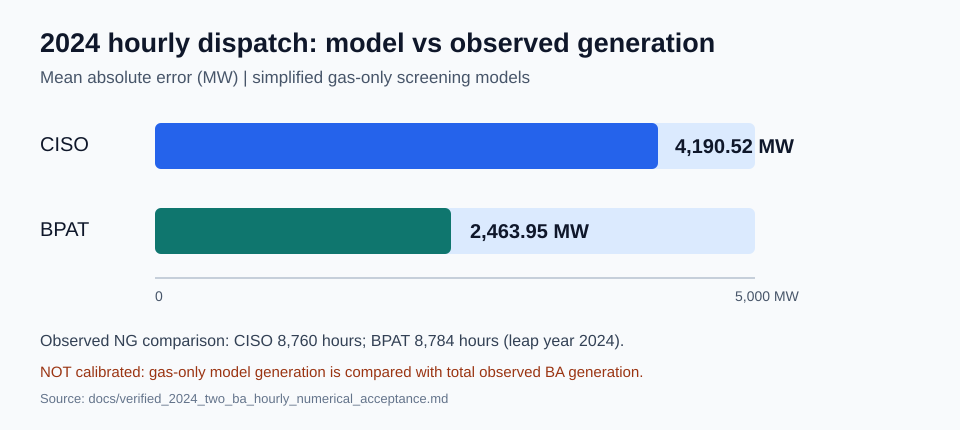
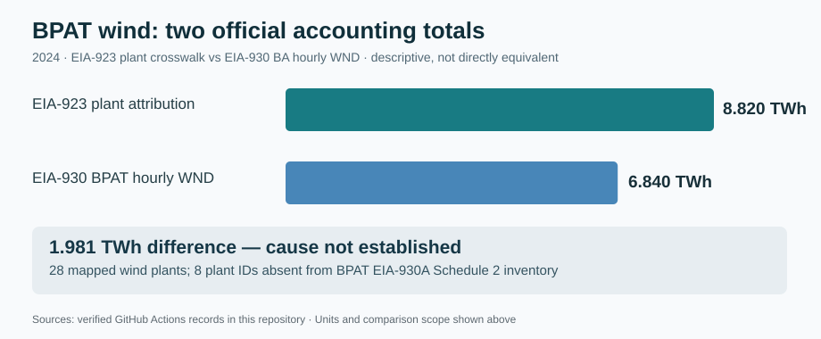
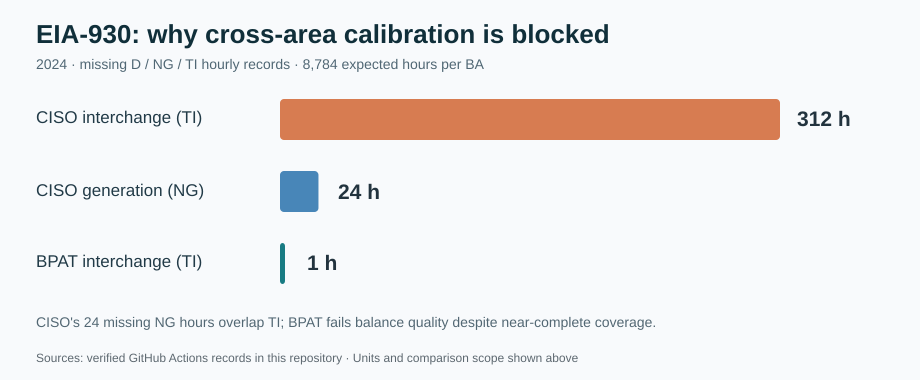
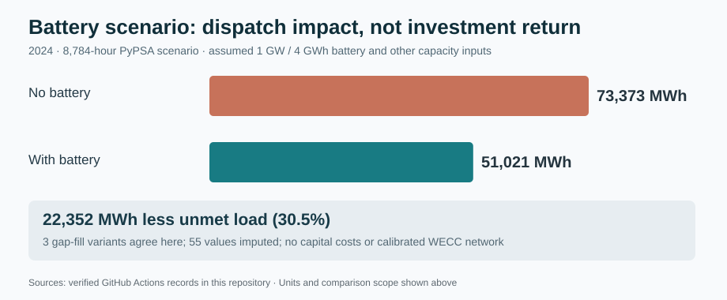

# Recruiter evidence brief | Western US PyPSA and EIA (2024)

**Scope:** Reproducible Python/PyPSA energy-system engineering, hourly US EIA data QA, source reconciliation, and assumption-conditioned optimization. **Not a calibrated Western Interconnection forecast.**

## Quantitative evidence

| Category | Verified result | Interpretation |
|---|---:|---|
| 2024 chronological dispatch | 8,784 hourly snapshots per CISO and BPAT pilot | Two **independent** gas-only screening models |
| CISO model-to-observed total NG MAE | 4,190.52 MW; 8,760 paired hours | Diagnostic model mismatch; not calibration |
| BPAT model-to-observed total NG MAE | 2,463.95 MW; 8,784 paired hours | Diagnostic model mismatch; not calibration |
| BPAT 2024 wind: EIA-923 plant sum | 8,820,435.41 MWh | Qualified plant-attributed accounting population |
| BPAT 2024 wind: EIA-930 WND | 6,839,734 MWh | BA hourly reported population |
| Signed source discrepancy | 1,980,701.41 MWh | Reporting populations differ; **not** curtailment or losses |
| BPAT EIA-930A reporting population | 20 of 28 plant IDs matched; 8 absent | Eight unmatched IDs account for 1,802,779 MWh; not a complete reconciliation |
| CISO EIA-930 interchange missingness | 312 hours (24 also missing NG) | Historical interchange calibration gate fails |
| BPAT EIA-930 interchange missingness | 1 hour | Historical interchange calibration gate fails |
| Storage screening, unmet load | 73,373 to 51,021 MWh | 22,352 MWh / 30.5% reduction under assumed 1 GW / 4 GWh battery |
| Storage objective difference | $315.9933 million | Includes $223.52 million assumed shortage penalties; excludes battery capex/degradation |

## Figures

## Three complementary research tracks

| Track | Primary research question | Distinct contribution | Current boundary |
|---|---|---|---|
| **A — Multi-year data & empirical validation** (this repo) | Can heterogeneous historical BA, generator, and geographic data be reconciled into reproducible model inputs? | Provenance, temporal completeness, BA accounting, load allocation, network ingestion and diagnostics | Western network is not historically calibrated |
| **B — Energy Transition Analysis** (same repo) | Under specified generation, transmission and storage scenarios, what changes in dispatch, costs, shortages and emissions? | PyPSA/HiGHS optimization and technology sensitivities | Scenario results are conditional on assumptions; no verified full multi-year Western planning model yet |
| **C — Climate & Grid Resilience** ([portfolio V1](https://github.com/ys30/Climate-Grid-Resilience-PyPSA), [research V2](https://github.com/ys30/Climate-Grid-Resilience-Research)) | How do extreme heat, wind and transfer constraints interact to affect adequacy? | Weather-linked stress scenarios, shortage duration, unserved energy, transfer sensitivity and factorial research design | Stylized topology/availability; modeled shortfalls are not observed blackouts |

**Architecture:** A supplies auditable data and calibration gates; B evaluates transition/technology choices; C tests weather-driven reliability under stress. A and B share a repository but should not be described as two independently validated studies.

## Source trail

- [2024 hourly model acceptance](verified_2024_two_ba_hourly_numerical_acceptance.md)
- [EIA-930 interchange diagnostics](eia930_2024_interchange_diagnostic_findings.md)
- [BPAT wind cross-source reconciliation](verified_bpat_wind_end_to_end_official_2024.md)
- [BPAT EIA-930A reporting population](verified_bpat_wind_eia930a_population_2024.md)
- [Storage gap-fill sensitivity](verified_annual_storage_gap_sensitivity_2024.md)
- [CI workflow](https://github.com/ys30/Energy-Transition-Analysis-PyPSA/actions/workflows/ci.yml)

**Recruiter-safe description:** Built automated, source-traceable hourly power-system data pipelines and PyPSA optimization prototypes; audited 2024 CISO/BPAT EIA-930 completeness, identified a 1.981 TWh BPAT wind reporting discrepancy, and quantified conditional storage dispatch sensitivities while documenting calibration limits.
